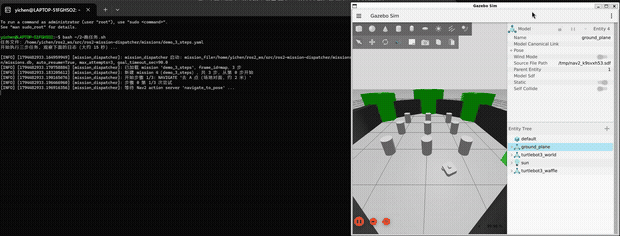

# mission_dispatcher

**在 ROS2 + Nav2 上做任务级调度与失败恢复**：把一份 YAML 任务计划拆成导航/等待步骤，逐步调用 Nav2 `NavigateToPose`，按失败类型决定退避重试还是终止；每一步的进度落 SQLite，进程被杀后重启可以按断点续跑。

这个仓库是一个求职作品集项目，目标不是做一个“能跑就行”的 demo，而是把**任务调度层的状态机、失败分类、幂等/续跑语义**讲清楚：

- 核心逻辑（`models.py` / `store.py`）是纯 Python，不 import rclpy，**没有 ROS2 也能 pytest**；
- ROS2 只是薄适配层（`node.py`）：发 goal、等 result、翻译状态、发状态话题、提供取消服务；
- 超时先 `cancel_goal_async` 再重试，避免两个 Nav2 goal 抢同一个底盘；
- 断点续跑按“整步重做”，不假装能恢复步骤内部的进度。



*三步任务实测：起点 → 场地对面（约 2 米）→ 停留 2 秒 → 返回。端到端 **22 秒**，3/3 成功。完整视频：[docs/demo.mp4](docs/demo.mp4)（26 秒）*

三个实验的数字（正常执行 / 目标不可达 / 中途崩溃续跑）在下面的 **实测结果** 一节。

---

## 目录结构

```text
ros2-mission-dispatcher/
├── package.xml                  # ROS2 包元数据与依赖
├── setup.py                     # ament_python 打包，console_scripts 入口
├── setup.cfg                    # ament_python 的脚本安装目录
├── resource/mission_dispatcher  # ament 包索引标记（空文件）
├── mission_dispatcher/
│   ├── __init__.py
│   ├── models.py                # 纯 Python：Step / StepOutcome / RetryPolicy / MissionState
│   ├── store.py                 # 纯 Python：SQLite 进度持久化、断点查询
│   └── node.py                  # rclpy 适配层：MissionDispatcher 节点 + main()
├── missions/
│   └── demo_3_steps.yaml        # 三步示例：导航 A → 等待 2s → 导航 B
├── test/
│   └── test_core.py             # 只测 models/store，不需要 ROS/Gazebo
├── docs/
│   └── architecture.md          # 状态机、失败分类、设计取舍、ROS2 API 待验证点
└── README.md
```

---

## 环境准备（Windows → WSL2 → Ubuntu 24.04 → ROS2 Jazzy）

> 目标环境：Windows 10/11 + WSL2 + Ubuntu 24.04 + ROS2 Jazzy + Gazebo + TurtleBot3 + Nav2。
> 所有命令在 **WSL 的 Ubuntu 终端** 里执行，除非特别标注 PowerShell。
> 下面命令以 ROS2 Jazzy 官方安装方式为准；如果包名在你的镜像里不存在，先用
> `apt-cache search ros-jazzy-<关键字>` 确认，不要硬背命令。

### 1. 安装 WSL2 与 Ubuntu 24.04（PowerShell）

```powershell
wsl --install -d Ubuntu-24.04
wsl --set-default-version 2
wsl --update
```

安装完成后从开始菜单打开 Ubuntu，设置 Linux 用户名/密码。之后所有开发都在这个终端里。

建议给 WSL 分配足够内存（Gazebo + Nav2 + RViz 比较吃内存）。在 Windows 用户目录新建/编辑
`C:\Users\<你的用户名>\.wslconfig`：

```ini
[wsl2]
memory=8GB
processors=4
```

然后 PowerShell 执行 `wsl --shutdown`，重新打开 Ubuntu 生效。

### 2. 在 WSL 里开启 systemd

WSL 默认不一定启用 systemd。ROS2 的很多工具/教程假设系统有 systemd，开启后更接近真实 Ubuntu，能减少“教程能跑我不能跑”的环境差异。

```bash
sudo tee /etc/wsl.conf > /dev/null <<'EOF'
[boot]
systemd=true
EOF
```

然后在 **PowerShell** 里关掉 WSL 再重开：

```powershell
wsl --shutdown
```

重新进入 Ubuntu 后验证：

```bash
systemctl list-units --type=service --state=running | head
```

能看到一堆 running 的服务就说明 systemd 起来了。

### 3. 安装 ROS2 Jazzy

```bash
sudo apt update && sudo apt install -y locales curl software-properties-common
sudo locale-gen en_US en_US.UTF-8
sudo update-locale LC_ALL=en_US.UTF-8 LANG=en_US.UTF-8
export LANG=en_US.UTF-8

sudo add-apt-repository universe -y
sudo apt update && sudo apt install -y curl

# 配置 ROS2 apt 源（Jazzy / Ubuntu 24.04 noble）
export ROS_APT_SOURCE_VERSION=$(curl -s https://api.github.com/repos/ros-infrastructure/ros-apt-source/releases/latest | grep -F "tag_name" | awk -F\" '{print $4}')
curl -L -o /tmp/ros2-apt-source.deb "https://github.com/ros-infrastructure/ros-apt-source/releases/download/${ROS_APT_SOURCE_VERSION}/ros2-apt-source_${ROS_APT_SOURCE_VERSION}.$(. /etc/os-release && echo $VERSION_CODENAME)_all.deb"
sudo dpkg -i /tmp/ros2-apt-source.deb

sudo apt update
sudo apt install -y ros-jazzy-desktop ros-dev-tools
```

把 ROS2 环境写进 `~/.bashrc`，以后新终端自动生效：

```bash
echo "source /opt/ros/jazzy/setup.bash" >> ~/.bashrc
source /opt/ros/jazzy/setup.bash
```

初始化 rosdep（只需一次；如果提示“already initialized”可以忽略并直接 update）：

```bash
sudo rosdep init
rosdep update
```

验证：

```bash
ros2 --version
ros2 pkg prefix nav2_bringup   # 现在可能还没有，下一步安装
```

### 4. 安装 Gazebo / Nav2 / TurtleBot3

```bash
sudo apt update
sudo apt install -y \
  ros-jazzy-navigation2 \
  ros-jazzy-nav2-bringup \
  ros-jazzy-ros-gz \
  ros-jazzy-turtlebot3 \
  ros-jazzy-turtlebot3-msgs \
  ros-jazzy-turtlebot3-simulations
```

说明：

- Jazzy 对应 Gazebo Harmonic，桥接包是 `ros-jazzy-ros-gz`；`ros-jazzy-turtlebot3-simulations` 提供 `turtlebot3_gazebo`。
- 如果 apt 找不到 `ros-jazzy-turtlebot3-simulations`，用源码方式补上（先确认分支存在，见仓库 README）：

```bash
mkdir -p ~/ros2_ws/src
cd ~/ros2_ws/src
git clone -b jazzy https://github.com/ROBOTIS-GIT/turtlebot3_simulations.git
git clone -b jazzy https://github.com/ROBOTIS-GIT/turtlebot3.git
# 源码方式的包需要一并编译（或之后在 ~/ros2_ws 执行不带 --packages-select 的 colcon build）
cd ~/ros2_ws && colcon build --symlink-install
```

- 如果 `ros2 launch nav2_bringup tb3_simulation_launch.py` 报找不到 `turtlebot3_gazebo`，先用
  `ros2 pkg prefix turtlebot3_gazebo` 确认装没装；没有就回到上一步。

设置 TurtleBot3 型号（默认 `burger`）：

```bash
echo 'export TURTLEBOT3_MODEL=burger' >> ~/.bashrc
export TURTLEBOT3_MODEL=burger
```

### 5. WSLg 图形界面提示

WSL2 自带 WSLg，可以显示 Gazebo / RViz。如果 Gazebo 黑屏、闪退或 OpenGL 报错，先强制软件渲染再启动：

```bash
export LIBGL_ALWAYS_SOFTWARE=1
```

软件渲染会慢一些，但稳定，适合这个项目。如果还是不行：

- 在 PowerShell 执行 `wsl --update`，确认 WSL 版本足够新；
- 确认 Windows 显卡驱动正常；
- 试试 `export GALLIUM_DRIVER=llvmpipe`；
- 先跑 `headless:=True` 确认仿真本身能起来，再排查显示问题。

### 6. 把项目放进 ROS2 工作区并编译

**不要在 `/mnt/c/...` 下直接 colcon build**：9p 文件系统慢，还可能出现权限/时间戳问题。复制到 WSL 的 ext4 工作区再编译。

```bash
mkdir -p ~/ros2_ws/src

# 只同步项目内容，排除测试/包管理器缓存，保持工作区干净
sudo apt install -y rsync
mkdir -p ~/ros2_ws/src/mission_dispatcher
rsync -a --exclude '.pytest_tmp*' --exclude '.piptmp' --exclude '__pycache__' \
  /mnt/c/Users/yichen/Documents/deepseek-harness/default-workspace/ros2-mission-dispatcher/ \
  ~/ros2_ws/src/mission_dispatcher/

cd ~/ros2_ws
rosdep install --from-paths src --ignore-src -r -y
colcon build --symlink-install --packages-select mission_dispatcher
source install/setup.bash
```

如果不想装 `rsync`，用 `cp -r` 复制整个目录也可以，但要确认没有把 `.pytest_tmp`、`.piptmp` 之类本机缓存带进去。

验证包已安装：

```bash
ros2 pkg prefix mission_dispatcher
ros2 pkg executables mission_dispatcher
# 期望输出：mission_dispatcher mission_dispatcher
```

`--symlink-install` 会让 Python 源码改动对 `install/` 生效；如果改的是 `package.xml`、`setup.py` 或新增文件，重新 `colcon build` 一次最稳。

### 7. 离线跑核心测试（不需要 ROS）

```bash
cd ~/ros2_ws/src/mission_dispatcher
python3 -m pytest test -q
```

如果提示没有 pytest：

```bash
sudo apt install -y python3-pytest
```

也可以直接在 Windows 上跑（`models.py` / `store.py` 只用标准库）：

```powershell
cd C:\Users\yichen\Documents\deepseek-harness\default-workspace\ros2-mission-dispatcher
python -m pip install pytest
python -m pytest test -q
```

> 测试不需要 PyYAML、rclpy、Gazebo。`node.py` 才会 import 这些。

---

## 运行方式（三个终端）

前提：三个终端都先加载环境：

```bash
source /opt/ros/jazzy/setup.bash
source ~/ros2_ws/install/setup.bash
```

### 终端 1：启动 Gazebo + Nav2 + TurtleBot3

```bash
export TURTLEBOT3_MODEL=burger
export LIBGL_ALWAYS_SOFTWARE=1   # WSLg 建议
ros2 launch nav2_bringup tb3_simulation_launch.py headless:=False
```

等 RViz 正常显示地图、机器人模型和代价地图。另开终端确认 Nav2 已就绪：

```bash
ros2 action list | grep navigate_to_pose
ros2 lifecycle get /bt_navigator
# 期望：active [3]
```

如果 `headless` 参数报未知，去掉 `headless:=False` 再启动。

### 终端 2：启动调度节点

```bash
source /opt/ros/jazzy/setup.bash
source ~/ros2_ws/install/setup.bash

MISSION_FILE="$(ros2 pkg prefix mission_dispatcher)/share/mission_dispatcher/missions/demo_3_steps.yaml"

ros2 run mission_dispatcher mission_dispatcher --ros-args \
  -p mission_file:="$MISSION_FILE" \
  -p db_path:="$HOME/ros2_ws/missions.db" \
  -p max_attempts:=3 \
  -p retry_backoff_sec:=1.0 \
  -p goal_timeout_sec:=90.0 \
  -p auto_resume:=true
```

参数说明：

| 参数 | 默认值 | 含义 |
|---|---|---|
| `mission_file` | 空 | YAML 任务计划路径；为空时节点只告警、不执行 |
| `db_path` | `missions.db` | SQLite 路径；相对路径会转成绝对路径打日志 |
| `max_attempts` | 3 | 单步最多执行次数（含第一次） |
| `retry_backoff_sec` | 1.0 | 指数退避基数：1s、2s、4s…（上限 30s） |
| `goal_timeout_sec` | 90.0 | 单个导航步骤的总 deadline（含等 server/等接受/等结果） |
| `auto_resume` | true | 启动时是否自动找未完成 mission 续跑 |

### 终端 3：看状态 / 取消任务

状态话题是 `/mission/status`（`std_msgs/String`，内容是 JSON）：

```bash
ros2 topic echo /mission/status --qos-durability transient_local
```

**注意 `--qos-durability transient_local`**：发布端用的是 transient_local + reliable + depth 1，目的是“晚启动的订阅者也能看到当前状态”。如果 echo 用默认的 volatile 订阅，只能看到之后新发布的消息，看不到最后一帧。

一条状态示例：

```json
{"mission_id": 1, "step_index": 1, "total_steps": 3, "state": "RUNNING", "attempts": 1, "error_code": null, "elapsed": 12.34}
```

取消任务：

```bash
ros2 service call /mission/cancel std_srvs/srv/Trigger "{}"
```

取消是协作式的：服务回调只设置取消标志，worker 线程在下一个检查点（最多约 50ms）检查；如果 Nav2 goal 正在执行，会先 `cancel_goal_async()` 再退出。不会强杀线程。

### 直接观察数据库

```bash
sudo apt install -y sqlite3   # 如果还没有 sqlite3 命令行
sqlite3 ~/ros2_ws/missions.db ".tables"
sqlite3 -header -column ~/ros2_ws/missions.db \
  "select id, label, state, updated_at from missions order by id;"
sqlite3 -header -column ~/ros2_ws/missions.db \
  "select * from steps where mission_id=1 order by step_index;"
```

---

## 架构说明：纯 Python 核心 + rclpy 薄适配层

```text
┌───────────────────────────── ROS2 进程（node.py） ─────────────────────────────┐
│                                                                                │
│  ActionClient ──────► /navigate_to_pose   (nav2_msgs/NavigateToPose)           │
│  Publisher   ──────► /mission/status      (std_msgs/String, JSON, QoS TL)       │
│  Service     ◄────── /mission/cancel      (std_srvs/Trigger)                    │
│                                                                                │
│  worker 线程：读 YAML → 顺序执行步骤 → 发 goal → 等 result → 重试/终止          │
│                    │                                                           │
│                    │ 只调用下面两个纯 Python 模块，不把 ROS 类型带进去            │
└────────────────────┼───────────────────────────────────────────────────────────┘
                     ▼
        ┌──────────────────────────────────────────────┐
        │ models.py                                    │
        │  Step / StepType / StepOutcome /             │
        │  MissionState / RetryPolicy                  │
        │  —— 失败分类、重试判定、退避公式、状态语义     │
        ├──────────────────────────────────────────────┤
        │ store.py                                     │
        │  SQLite：missions / steps                    │
        │  —— 每步落库、事务、WAL、断点查询              │
        └──────────────────────────────────────────────┘
                     ▲
                     │ 直接 import + pytest
        ┌────────────┴─────────────┐
        │ test/test_core.py        │
        │ 不需要 ROS / Gazebo       │
        └──────────────────────────┘
```

为什么这样分层：

1. **可离线测试**：调度规则（REJECTED 不重试、ABORTED 重试、TIMED_OUT 先取消、CANCELED 不重试）是纯逻辑。把它放在 `node.py` 里，就必须装 ROS2 才能验证；放在 `models.py` 里，Windows 上 `pytest` 就能测。
2. **逻辑与通信解耦**：Nav2 的 `GoalStatus` 是通信层的状态码，不是业务语义。`node.py` 负责翻译，`models.py` 负责决策。以后换 BehaviorTree.CPP、换 Action 接口、甚至换机器人中间件，核心状态机不用重写。
3. **可讲清楚**：可以先画 `models.py` 的状态机，再说明 `node.py` 如何把 ROS2 事件映射进来。这样重点在“设计”，而不是“我调通了哪个 launch 文件”。

更细的设计（状态机图、四种 outcome 的处理表、为什么不用 BehaviorTree.CPP、线程模型、ROS2 API 待验证点）见 [docs/architecture.md](docs/architecture.md)。

---

## 三个实验

> 建议每个实验用**独立的 db 文件**（`exp1.db` / `exp2.db` / `exp3.db`），避免上一次的 mission 干扰 `auto_resume`。
> 记录数据时把下面的 `X` 换成实测值，填进「待填数字」表。

### 实验 ①：正常三步任务

用 `missions/demo_3_steps.yaml` 原样跑：

```bash
ros2 run mission_dispatcher mission_dispatcher --ros-args \
  -p mission_file:="$(ros2 pkg prefix mission_dispatcher)/share/mission_dispatcher/missions/demo_3_steps.yaml" \
  -p db_path:="$HOME/ros2_ws/exp1.db" \
  -p auto_resume:=false
```

预期：

1. 日志出现 `新建 mission 1 ... 共 3 步`；
2. 机器人先去 A 点，停 2 秒，再回 B 点；
3. `/mission/status` 依次出现 `RUNNING`（step_index 0/1/2），最后 `state=DONE`；
4. `sqlite3 ~/ros2_ws/exp1.db "select step_index,state,attempts from steps"` 三行都是 `SUCCEEDED`，`attempts=1`。

要记录：

- 端到端耗时（从节点启动到 `DONE`）：`X` 秒
- 每步导航耗时：`X` / `X` / `X` 秒
- 一次成功率：`X%`

如果机器人到不了 A/B：在 RViz 用 **2D Goal Pose** 手动点一下，确认可达；把地图上合适的坐标改回 YAML。demo 坐标只是默认 TurtleBot3 世界的示例，**换地图必须重测**。

### 实验 ②：把目标点设在障碍物里，制造 aborted，观察重试

复制一份 YAML，把第二个 NAVIGATE（回 B 点）的坐标改到墙里（用 RViz 的 **Publish Point** 点墙，终端 `ros2 topic echo /clicked_point` 读 x/y）：

```bash
cp "$(ros2 pkg prefix mission_dispatcher)/share/mission_dispatcher/missions/demo_3_steps.yaml" /tmp/exp2.yaml
# 编辑 /tmp/exp2.yaml，把最后一个 NAVIGATE 的 x/y 改成墙内坐标
```

启动：

```bash
ros2 run mission_dispatcher mission_dispatcher --ros-args \
  -p mission_file:=/tmp/exp2.yaml \
  -p db_path:="$HOME/ros2_ws/exp2.db" \
  -p max_attempts:=3 \
  -p retry_backoff_sec:=1.0 \
  -p auto_resume:=false
```

观察日志：

```text
步骤 2 第 1 次失败（ABORTED），1.00s 后重试
步骤 2 第 2 次失败（ABORTED），2.00s 后重试
...
步骤 2 结果为 ABORTED，按策略不再重试
mission 1 结束: FAILED
```

注意：Nav2 对“墙里的目标”可能返回 **ABORTED**（规划失败），也可能在 goal 接受阶段直接 **REJECTED**（目标非法）。两种情况都值得记录：

- 如果是 ABORTED：应该看到 3 次尝试和 1s/2s 退避；
- 如果是 REJECTED：应该只尝试 1 次就失败——这正好验证“前置条件不满足不重试”的分类。

要记录：

- 实际 outcome 是 `ABORTED` 还是 `REJECTED`：`X`
- 实际尝试次数：`X`
- 相邻重试间隔（应约 1s、2s）：`X` / `X`
- 最终状态：`X`

### 实验 ③：任务中途 kill 节点，再启动，观察续跑

为了有足够时间下手，把 demo 里的等待从 2 秒改成 20 秒，并用独立 db：

```bash
sed 's/seconds: 2.0/seconds: 20.0/' \
  "$(ros2 pkg prefix mission_dispatcher)/share/mission_dispatcher/missions/demo_3_steps.yaml" > /tmp/exp3.yaml
```

启动：

```bash
ros2 run mission_dispatcher mission_dispatcher --ros-args \
  -p mission_file:=/tmp/exp3.yaml \
  -p db_path:="$HOME/ros2_ws/exp3.db" \
  -p auto_resume:=true
```

等日志出现“步骤 1 第 1/3 次尝试”（0-based 的第 2 步，正在 20 秒等待）时，另开终端：

```bash
pgrep -af mission_dispatcher
kill -9 <上一步看到的 PID>
```

确认进程死了，然后用**完全相同的命令**重启。预期日志：

```text
发现未完成 mission 1，已完成 1 步；将按「整步重做」策略从下一步的边界继续
续跑 mission 1，从第 1 步继续（共 3 步）
步骤 1 第 1/3 次尝试
```

也就是：第 0 步不会重做；第 1 步（20 秒等待）**从头再等一遍**；然后继续第 2 步，最终 `DONE`。

要记录：

- 重启后从第几步继续：`X`
- 第 1 步是否整步重做（等待是否重新计时）：`X`
- 续跑后端到端耗时：`X` 秒
- 续跑成功率：`X%`

> 为什么不建议在导航中途 kill：节点被 `kill -9` 后，Nav2 里那个 goal 可能还在执行；重启后调度器发的新 goal 会与旧 goal 竞争（Nav2 通常会抢占，但不要依赖）。在 `WAIT` 步骤 kill 最干净，能单独验证“进度持久化 + 断点计算”。

---

## 实测结果（2026-11-12，WSL2 + Ubuntu 24.04 + ROS2 Jazzy + Gazebo）

一次完整跑通的三组数据。样本量都是 1 次，够用来验证链路，不够用来声称成功率——后面补跑再加。

### 实验 ①：正常三步任务

| 指标 | 数值 |
|---|---|
| 端到端耗时 | **11.0 秒**（导航 3.7s + 等待 2.0s + 导航 5.6s） |
| 步数 | 3 / 3 `SUCCEEDED` |
| 每步尝试次数 | 各 1 次 |
| 最终状态 | `DONE` |

```text
步骤 0 导航成功                         ← 3.7s
开始步骤 2/3: WAIT 2 秒
开始步骤 3/3: NAVIGATE '回到出生点'
步骤 2 导航成功                         ← 5.6s
mission 1 结束: DONE（所有步骤执行成功）
```

### 实验 ②：目标点在地图外（10, 10）

这一组跑出了本项目的核心发现，**同一个场景在改进前后差了 9 倍**：

| | 改进前 | 改进后 |
|---|---|---|
| Nav2 返回 | `GoalStatus=6 (ABORTED)`, `error_code=204` | 同左 |
| 分类结果 | `ABORTED` → **重试 3 次** | 识别 `GOAL_OUTSIDE_MAP` → `REJECTED` → **只试 1 次** |
| 耗时 | **3.6 秒** | **0.4 秒** |
| 数据库 | `attempts=3`, `FAILED` | `attempts=1`, `FAILED` |

Nav2 侧的原始原因：

```text
[planner_server]: GridBased plugin failed to plan from (-2.00, -0.50) to (10.00, 10.00):
                  "Goal Coordinates of(10.000000, 10.000000) was outside bounds"
[bt_navigator]: [navigate_to_pose] [ActionServer] Aborting handle.
```

**为什么值得记一笔**：`NavigateToPose` 的 `GoalStatus` 只有 SUCCEEDED / ABORTED / CANCELED 三种终态，
"目标在地图外"和"执行中卡住"返回的都是 `ABORTED(6)`。只按 GoalStatus 分类，就会对一个
永远不可能成功的目标重试三次。真正能区分的是 `result.error_code`（取值来自
`ComputePathToPose` 的枚举）：

| error_code | 含义 | 策略 |
|---|---|---|
| 201 | INVALID_PLANNER | 不重试（配置错误） |
| 203 | START_OUTSIDE_MAP | 不重试（定位坏了） |
| 204 | GOAL_OUTSIDE_MAP | 不重试 |
| 205 | START_OCCUPIED | 不重试（机器人被卡住/定位错） |
| 206 | GOAL_OCCUPIED | 不重试 |
| 202 | TF_ERROR | 重试（可能是瞬时） |
| 207 | TIMEOUT | 重试 |
| 208 | NO_VALID_PATH | 重试（动态障碍可能让开） |

### 实验 ③：第 2 步中途 kill -9，再启动

崩溃瞬间的数据库：

```text
mission: (1, 'exp_resume', 'RUNNING')
  step (0, 'SUCCEEDED', 1)
  step (1, 'RUNNING',   1)   ← 崩在这一步
  step (2, 'PENDING',   0)
```

重启（`auto_resume:=true`）后：

```text
[WARN] 发现未完成 mission 1，已完成 1 步；将按「整步重做」策略从下一步的边界继续
[INFO] 续跑 mission 1，从第 1 步继续（共 3 步）
[INFO] 开始步骤 2/3: WAIT '第二步：停留 15 秒（kill 窗口）'
[INFO] 开始步骤 3/3: NAVIGATE '回到出生点'
mission 1 结束: DONE
```

| 指标 | 数值 |
|---|---|
| 续跑起点 | 第 1 步（不是从头，也不是从第 2 步） |
| 重复执行的步数 | **1 步**（被中断的那一步整步重做） |
| 最终状态 | `DONE`，三步全 `SUCCEEDED` |

**"整步重做"不是偷懒**：被中断的 WAIT 从剩余 7 秒重新等满 15 秒。因为真实场景里那一步
可能是机械臂抓取，动作不可回滚，只能整步重做——"至少执行一次"，不是"恰好一次"。

### 三个必须先知道的坑（都踩过）

1. **初始位姿必须早于 `global_costmap` 激活**。AMCL 收不到 `/initialpose` 就不发 `map→odom`，
   `global_costmap` 等 TF 约 60 秒后超时 → `planner_server` 激活失败 → `bt_navigator` 保持
   `inactive` → 所有 goal 被拒（`Action server is inactive. Rejecting the goal.`）。
   正确做法：仿真起来后**立刻**发 `/initialpose`（`stamp` 用 0），再等 lifecycle 就绪。
2. **必须保证单实例**。两套 `tb3_simulation_launch` 同时跑时，`ros2 node list` 会直接返回空、
   `ros2 lifecycle get` 全部无响应——不是进程没了，是 ROS 图被同名节点污染了。
   做实验前 `wsl --terminate Ubuntu-24.04` 最省事。
3. **root 与普通用户混跑会撞 FastDDS 共享内存**：`Failed init_port fastrtps_port7000:
   open_and_lock_file failed`。全程用同一个用户，并固定 `FASTDDS_BUILTIN_TRANSPORTS=UDPv4`。

---

## 已知边界（刻意没做，而不是不知道）

- **单进程、单机器人**：一个调度节点控制一个机器人；没有多机协调、分布式锁、任务队列。两个调度节点同时跑会互相抢 Nav2 goal。一个进程一次只执行一个 mission，结束后节点保持空闲（idle），不会自动接下一个 YAML。
- **只有仿真，没有真实机器人**：所有结论来自 Gazebo + TurtleBot3；真实底盘的定位漂移、通信延迟、急停策略都没覆盖。
- **续跑是“整步重做”**：不恢复步骤内部进度。例如“等待 20 秒”在第 10 秒被杀，重启会重新等 20 秒；导航到一半被杀，会重新发同一个目标（Nav2 自己重新规划）。
- **续跑时世界状态可能已变**：地图、障碍物、机器人位置都可能和崩溃前不同；当前实现不校验这些，直接重发步骤目标。这是“至少执行一次”语义，不是“恰好一次”。
- **计划不落库**：数据库只存进度，YAML 是计划的唯一来源。续跑必须提供同一份 `mission_file`；如果 YAML 步数变了，会把旧 mission 标 `FAILED` 并新建；如果步数没变但坐标/标签改了，当前**不会检测**，会按新计划继续（语义漂移风险，明确留作后续改进）。同理，换一份**步数相同**的 YAML 会被当成同一任务续跑；做实验时请用独立 db，生产版应该存计划哈希或 mission 名称。
- **超时取消是异步的**：`cancel_goal_async()` 返回成功只代表 Nav2 接受了取消请求，不代表底盘已经停稳；本实现只保证“取消请求先发出，再判定 TIMED_OUT”。极端情况下旧 goal 的残余运动可能还存在。
- **`kill -9` 不会清理 Nav2 goal**：调度进程死了，Nav2 里正在执行的 goal 可能还在跑；重启后续跑的新 goal 可能与它竞争。
- **goal 接受阶段超时没有 handle**：如果 `send_goal_async` 的响应超时，我们还没拿到 `goal_handle`，无法 cancel；为避免重复 goal，本实现按 `REJECTED` 不重试并报错，需要人工检查 Nav2/DDS。
- **没有 Nav2 生命周期管理**：假设 Nav2 已启动且 `bt_navigator` 处于 active；节点不会替你激活或重启 Nav2。
- **状态话题只有最后一帧**：QoS 是 depth=1 + transient_local，适合“看当前状态”，不适合回放历史；历史在 SQLite 里。
- **SQLite 是单机方案**：WAL 对单机多线程友好，但不适合网络文件系统/多机共享；生产级调度应换成服务端存储 + 分布式锁。
- **没有认证/权限控制**：`/mission/cancel` 任何能发 ROS2 服务的节点都能调用；只适合实验环境。

---

## 常见问题排查

| 现象 | 排查 |
|---|---|
| `ros2 pkg prefix mission_dispatcher` 为空 | 没 `source install/setup.bash`，或 colcon build 失败；回看 build 输出 |
| 节点报 “Nav2 action server ... 未就绪” | 仿真没起、Nav2 没 active、或 `TURTLEBOT3_MODEL` 没设；用 `ros2 action list \| grep navigate_to_pose` 和 `ros2 lifecycle get /bt_navigator` 确认 |
| `ros2 topic echo /mission/status` 没输出 | 没加 `--qos-durability transient_local`，或节点还没发布过状态（等 mission 开始） |
| Gazebo 黑屏/闪退 | `export LIBGL_ALWAYS_SOFTWARE=1`；`wsl --update`；先试 `headless:=True` |
| `colcon build` 在 `/mnt/c` 下很慢/报权限 | 复制到 `~/ros2_ws/src` 再编译 |
| `rosdep install` 报找不到依赖 | 先 `sudo rosdep init`（仅一次）+ `rosdep update`；确认 apt 源已加 |
| 机器人不动但 goal 被接受 | 看 Nav2 日志和 RViz 代价地图；检查初始定位（AMCL）是否正确 |
| 测试报 `ModuleNotFoundError: mission_dispatcher` | 在项目根目录执行 `python -m pytest test -q`；测试文件会把项目根加入 `sys.path` |
| 仿真时间/`use_sim_time` 警告 | 由 `tb3_simulation_launch.py` 统一设置，一般可忽略；不要手动混用系统时间和仿真时间 |

---

## 开源贡献

- **Nav2**（ROS2 官方导航栈）：[PR #6782](https://github.com/ros-navigation/navigation2/pull/6782)
  —— **已由维护者合入主干**（merge commit `b3b6e60`）。修正 `tb3_simulation_launch.py` 中 `headless` 参数的描述：
  去掉多余的右括号，并说明「`headless` 默认为 `True`，即不启动 gzclient 界面，需要 `headless:=False` 才能看到仿真窗口」。
  这个改动来自本项目的真实踩坑——按 README 启动却看不到 Gazebo，最后靠 `ps` 发现子进程是 `gz sim -r -s` 才定位到原因。
  提交流程：fork → 分支 → DCO 签名（`Signed-off-by`）→ CI（Lint / 构建）全绿 → merge。
  期间 CI 曾因一处缩进错误导致文件无法解析、三项检查同时失败，修复后才转绿。
